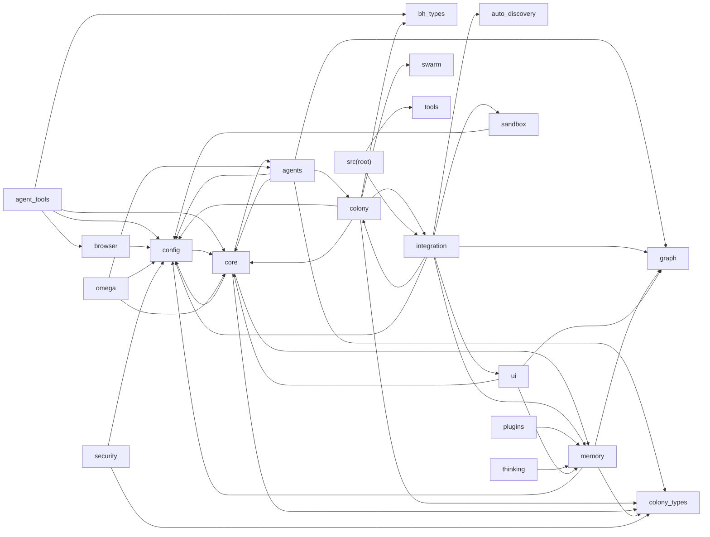

# BlackHornet — Module Dependency Graph

> **GENERATED FILE** — do not edit by hand.
> Regenerate with `python3 scripts/gen_arch_graph.py` and commit the result.
> Graph granularity is package-level (direct children of `src/`); only
> *internal* `src.*` imports are drawn, standard-library and third-party
> imports are excluded. Deterministic (sorted) output.

- Packages: **20** + 10 loose ops-line module(s) at `src/` root
- Internal cross-package import edges: **49**
- Total Python files under `src/`: **310**

## 1. Package dependency graph

## 2. Package inventory

Sorted by fan-in (how many packages import it) — the load-bearing
subsystems sit at the top.

| Package | Files | LOC | Fan-in | Fan-out |
|---|---:|---:|---:|---:|
| `config` | 3 | 528 | 10 | 1 |
| `core` | 32 | 8,760 | 6 | 5 |
| `colony_types` | 10 | 2,215 | 5 | 0 |
| `memory` | 23 | 9,339 | 5 | 3 |
| `graph` | 8 | 1,183 | 4 | 0 |
| `agents` | 44 | 10,118 | 2 | 6 |
| `bh_types` | 7 | 1,874 | 2 | 0 |
| `colony` | 39 | 9,523 | 2 | 7 |
| `integration` | 11 | 1,658 | 2 | 7 |
| `auto_discovery` | 10 | 3,542 | 1 | 0 |
| `browser` | 5 | 763 | 1 | 1 |
| `sandbox` | 8 | 1,129 | 1 | 2 |
| `swarm` | 7 | 1,470 | 1 | 0 |
| `tools` | 23 | 4,672 | 1 | 0 |
| `ui` | 9 | 1,252 | 1 | 3 |
| `agent_tools` | 25 | 9,147 | 0 | 5 |
| `omega` | 12 | 1,388 | 0 | 3 |
| `plugins` | 3 | 286 | 0 | 1 |
| `security` | 4 | 1,619 | 0 | 2 |
| `thinking` | 17 | 2,565 | 0 | 1 |
| `src/` root (ops line) | 10 | 3,773 | 0 | 2 |

## 3. Loose ops-line modules (`src/` root)

| Module | Purpose hint |
|---|---|
| `src/colony_bridge.py` | colony bridge protocol exports |
| `src/exceptions.py` | shared exception types |
| `src/hermes_quant.py` | paper-trading main loop (L1–L5) |
| `src/immortal_daemon.py` | immortal-daemon ops shell |
| `src/memory_bridge.py` | BH bridge protocol v1 peer |
| `src/swarm_protocol.py` | swarm wire protocol |
| `src/upgrade_loop.py` | self-upgrade loop |
| `src/user_alignment.py` | user alignment checks |
| `src/watchdog.py` | service watchdog |

## 4. Coupling notes

- Most depended-upon: `config` (10 inbound), `core` (6 inbound), `colony_types` (5 inbound).
- Orphan packages (no internal edges): none

