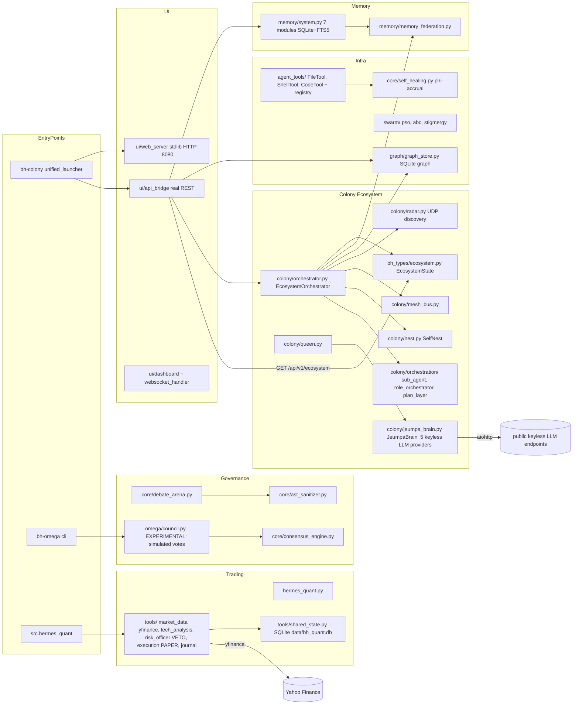
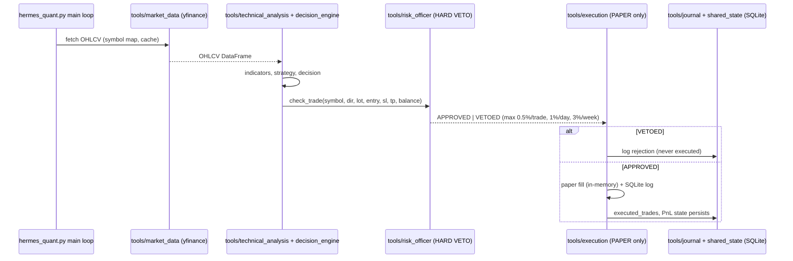

# BlackHornet — Architecture (v7.0.0)

> Rewritten for the v7.0.0 clean rebuild (2026-10-27). This document describes the
> **v7 target state**: what the rebuild keeps, what it removed, and how the kept
> subsystems are wired. It is evidence-based — the pre-rebuild audit that produced
> the verdicts below is summarized in `PLAN.md` (sources: Task 12-d-1 architect
> findings and Task 12-d-2 audit). Honesty rules: no feature is described as more
> than it is; simulated components are labeled simulated.

---

## 1. What BlackHornet is

A Python **autonomous agent colony platform** (Python ≥ 3.11, package
`blackhornet-colony`): cooperating agent processes with federated memory, a live
ecosystem state exposed over HTTP, keyless LLM access, a sandboxed tool registry,
swarm-intelligence algorithms, and a **paper-only** trading stack — served through a
zero-dependency dashboard.

Pre-v7 the repo was a five-lineage fusion (AMC core, deer-flow harness, Hermes
quant, immortal-daemon shell line, colony ecosystem v2) in which several headline
features were stubs or unimportable. v7 keeps the subsystems that actually work,
drops the rest, and labels the experimental remainder honestly.

## 2. Module map (v7 target)

```
blackhornet/
├── pyproject.toml            # blackhornet-colony 7.0.0; entry points bh-colony, bh-omega
├── requirements.txt          # slim, declared-only deps (pydantic >=2,<3)
├── hermes.sh / deploy.sh     # service control + watchdog
├── Dockerfile / docker-compose.yml / deploy/   # container deploys (non-root)
├── src/
│   ├── colony/               # ECOSYSTEM CORE: EcosystemOrchestrator, ColonyRadar (UDP),
│   │   │                     #   MeshBus, SelfNest, QueenAgent, jeumpa_brain.py
│   │   └── orchestration/    # sub_agent, role_orchestrator, plan_layer, pool, rpc_pipeline
│   ├── bh_types/             # the ONE type system (incl. canonical EcosystemState)
│   ├── memory/               # SQLite+FTS5 7-module system + MemoryFederation
│   ├── core/                 # consensus_engine, debate_arena, ast_sanitizer,
│   │   │                     #   self_healing (phi-accrual), llm_provider, workforce
│   ├── agent_tools/          # FileTool/ShellTool/CodeTool + registry (circuit breaker,
│   │                         #   rate limit, permissions, path sandboxing)
│   ├── tools/                # paper trading stack: market_data (yfinance), technical
│   │   │                     #   analysis, risk_officer_tool (HARD VETO), execution
│   │   │                     #   (PAPER), journal, shared_state (SQLite)
│   ├── swarm/                # PSO / ABC / stigmergy (real math)
│   ├── graph/                # SQLite property graph + session recorder
│   ├── omega/                # governance loop + council (EXPERIMENTAL, simulated debate)
│   ├── ui/                   # stdlib web_server (:8080) + api_bridge (the ONE API/UI)
│   ├── integration/          # unified_launcher (bh-colony entrypoint)
│   ├── config/, security/, sandbox/, thinking/   # supporting modules
│   ├── hermes_quant.py       # paper-trading main loop (L1–L5)
│   └── immortal_daemon.py, watchdog.py, swarm_protocol.py   # ops line
├── tests/                    # pytest suite (474 passed / 28 skipped as of the Task 21 tidy, 2026-10-29)
├── docs/                     # this doc, numbered tree, changelog
└── PLAN.md                   # rebuild plan + Rust roadmap
```

A **generated, always-current** package-level dependency graph lives in
[`docs/02-arch/MODULE_GRAPH.md`](02-arch/MODULE_GRAPH.md) — regenerate with
`python3 scripts/gen_arch_graph.py` after any structural change. Current shape:
20 packages + 10 loose ops-line modules, 49 internal import edges; the most
depended-upon packages are `config` (10 inbound), `core` (6), `colony_types` (5).

## 3. Entrypoints

| Command | What starts |
|---|---|
| `bh-colony` | Unified launcher: event bus, graph store + tracker, memory system, API bridge, stdlib web server on :8080, dashboard, provider hub. Serves `GET /api/v1/ecosystem`. |
| `bh-omega` | Omega engine boot + main loop. **Experimental:** loop content is simulated (§6). |
| `python -m src.hermes_quant` | Paper-trading loop (long-running): yfinance data → analysis → risk veto → paper fills → SQLite journal. Telegram alerts only if `TELEGRAM_*` env vars are set. No broker connectivity exists. |
| `pytest tests/ -q` | 474 passed / 28 skipped (Task 21 tidy, 2026-10-29) — the gate for every change. |
| `hermes.sh` / `deploy/` | Watchdog + service control (host/Termux/container). |

## 4. Dependency map



## 5. Runtime data flows

### 5.1 Agent turn — Queen command → intelligence → memory/state

The colony line is the only fully-wired real agent turn:

```mermaid
sequenceDiagram
    participant U as Client (TUI/curl)
    participant WS as ui/web_server :8080
    participant AB as ui/api_bridge
    participant OR as colony/orchestrator (EcosystemOrchestrator)
    participant ES as bh_types/ecosystem.EcosystemState
    participant Q as colony/queen.QueenAgent
    participant JB as colony/jeumpa_brain.JeumpaBrain
    participant MS as memory/system.MemorySystem
    participant MF as memory/memory_federation.MemoryFederation

    U->>WS: HTTP GET/POST /api/...
    WS->>AB: route dispatch
    AB->>OR: get_status_snapshot() / command
    Note over OR: sync loop: collect radar/mesh/nest/<br/>agents/graph status into EcosystemState
    OR->>ES: enqueue_task / register_agent / append_audit
    OR->>MF: feed ecosystem snapshot each cycle (importance 0.9, max 20)
    MF->>MS: federated memory store
    U->>Q: command("ask", text=...)
    Q->>JB: chat(prompt, task profile)
    JB->>JB: try keyless providers in order (cooldowns, 429 backoff, cache)
    JB-->>Q: JeumpaResult(content, provider, latency)
    Q-->>AB-->>WS-->>U: JSON answer
```

### 5.2 Trading turn — paper only



No broker adapter exists in the codebase; MT5/OANDA/Binance names that appeared in
pre-v7 config were labels without implementations and are gone in v7.

## 6. Honest subsystem verdicts

| Subsystem | Verdict |
|---|---|
| Memory system + MemoryFederation | REAL — SQLite+FTS5, dedupe/merge/importance/TTL, tested |
| EcosystemOrchestrator + EcosystemState | REAL — sync loop, canonical state, `GET /api/v1/ecosystem` |
| ColonyRadar / MeshBus / SelfNest | REAL code — multi-instance mesh exercised by unit tests only; no second colony ships |
| Jeumpa Brain | REAL — 5 keyless public endpoints, task profiles, cooldowns, cache; third-party endpoints, best-effort |
| Tool registry + File/Shell/Code tools | REAL — circuit breaker, rate limits, path sandboxing |
| Trading stack + RiskOfficer | REAL and **PAPER-ONLY** — hard veto, SQLite journal; not financial advice |
| Swarm (PSO/ABC/stigmergy), self-healing, graph store | REAL — algorithm libraries |
| **Omega Engine + Council** | **EXPERIMENTAL / SIMULATED** — boot, constitution, scoring are real bookkeeping; the plan→execute loop and 15-persona votes return template strings and produce no real work. Do not rely on it until the debaters are LLM-backed |
| **SAMAN governance engine** | ENGINE REAL, DEBATERS SIMULATED — consensus math (score ≥ 0.85, 3 rounds, fail-closed) is genuine; wired debaters are stubs |
| Unified launcher | REAL but partial — starts the dashboard/API/memory stack; does not start the colony orchestrator, trading bot, or omega |

The repo-wide "fake success" pattern (modules returning plausible canned strings)
is banned in v7: components must return explicit degraded/failed states.

## 7. Persistence

No ORM in the live path — all stdlib `sqlite3` / JSON:

| Store | Tech | Path |
|---|---|---|
| Trading journal / risk state | sqlite3 | `data/bh_quant.db` |
| Memory (STM/LTM/semantic/episodic) | sqlite3 + FTS5 | `~/.bh/memory/` |
| Knowledge graph | sqlite3 | auto-created graph store file |
| Omega second brain | JSON | `data/omega/second_brain.json` |
| Sessions / exports | JSON + MD | `data/sessions.json`, `exports/` (gitignored since v7) |
| Key-value backend | redis / file / memory | `data/persistence/` (`PERSISTENCE_BACKEND`) |
| Swarm sync | git repo | `~/.hermes/agent-sync` (`swarm_protocol.py`) |

## 8. Removed in v7

Dropped by the rebuild (rationale and per-item risk analysis in `PLAN.md` §2):

| Removed | Why |
|---|---|
| `src/harness/` (deer-flow port, 224 files) | Needed undeclared langchain/langgraph — dead in any requirements-driven env |
| `src/api/` (FastAPI stack) | Orphaned — nothing called it; the real API is `src/ui/api_bridge.py` |
| `src/channels/` | Import-crashed at class-definition time |
| `src/mcp/` + `mcp_tool.py` | Import-crashed (pydantic v1/v2 clash); superseded by the roadmap's MCP-bridge plan |
| `src/llm_router/*.mjs`, `src/delta/*.mjs` | Node islands unreachable from Python |
| `src/colony_types/` | Duplicate type system vs `bh_types/` |
| `src/integrations/` | Twin of `src/integration/`; served only the orphaned API |
| 102 template agents (`audit/*`, `specialists/*`) | Near-identical generated files, zero unique behavior |
| `skills/`, loose daemon `scripts/` | Tooling artifacts / overlapping daemons, not product code |
| `hypergate.py`, `mnemosyne_bridge.py`, `hermes_nous/layers.py` | Unwired glue to repos outside this codebase |
| `ui/` "Living World" game | Second UI with a second port; separated from the product |
| Root marketing/status docs; `data/`, `exports/` runtime state | Historical noise / runtime artifacts, no longer tracked |

## 9. Configuration

Credentials come from environment variables only (names, never values, belong in
docs): `TELEGRAM_BOT_TOKEN`, `TELEGRAM_CHAT_ID`, `GROQ_API_KEY*`, `NVIDIA_API_KEY`,
`OPENCODE_API_KEY*`, `MODEL_NAME`, `DATA_DIR`, `LOG_DIR`, `PERSISTENCE_BACKEND`,
`PORT`, `HOST`. Jeumpa Brain needs no keys (public endpoints). No `.env` file is
committed; a historical leak of one is the reason the pre-v7 history was retired.

## 10. Tests

`pytest tests/ -q` → **474 passed / 28 skipped / 0 failed** as of the Task 21
repo-tidy pass (2026-10-29; the v7 rebuild baseline was 366 / 22 — the suite
grew through Phases 3–5 and the Task 19 parity work). Coverage is unit/self-test
heavy; no test drives a real LLM turn end-to-end. Every tidy/feature change must
keep the suite green.

## 11. Known limitations

1. Omega loop and council debate are simulated (§6) — the flagship "autonomy" is scaffolding.
2. Jeumpa providers are free public endpoints: availability and output quality vary.
3. Single-node colony: radar/mesh have no second instance to talk to out of the box.
4. Trading backtest engine is simplistic; yfinance is the only live data source.
5. No CI pipeline runs the suite yet; tests are local-gated.

## 12. Roadmap

Rust + hydro-project/infinity strangler-fig (phases 0–5, `BH_RUNTIME=python`
default, trading money-path excluded until Phase 5+): see `PLAN.md` §4 and the
Roadmap section of the README.

## 13. Documentation map

The numbered doc tree is the canonical home for each document class; loose
files at `docs/` root that predate the tree were folded back into it during
the Task 21 tidy (2026-10-29).

| Slot | Contents |
|---|---|
| `docs/ARCHITECTURE.md` | **This document** — canonical architecture (kept loose: `Constitution.REQUIRED_CORE_DOCS` checks this exact path, and README/PLAN link it) |
| `docs/00-vision/` … `docs/03-spec/` | Vision, PRD, architecture pointers, SPEC + [API reference](03-spec/api.md) |
| `docs/02-arch/MODULE_GRAPH.md` | Generated package dependency graph (`scripts/gen_arch_graph.py`) |
| `docs/07-security/`, `docs/14-rules/` | Security notes, project rules |
| `docs/09-testing/` | Testing policy |
| `docs/10-roadmap/`, `docs/12-tasks/` | Roadmap, task list, archived dated plans (`12-tasks/plans/`) |
| `docs/11-adr/` | Architecture decision records |
| `docs/13-changelog/` | Historical changelog + SAMAN audit |
| `docs/17-glossary/` | Glossary |

Gaps the tree still has on purpose (honesty rule): `04`–`06`, `08`, `15`, `16`
are unassigned; no placeholder files are kept for them.
